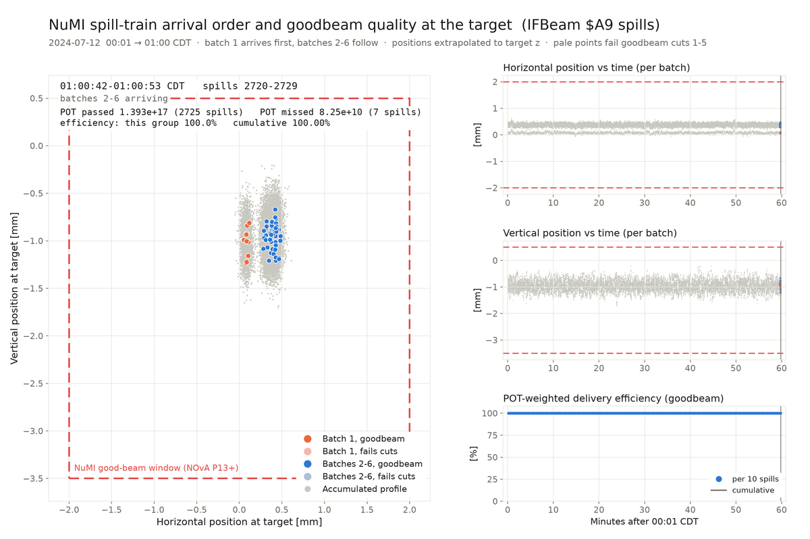

# NuMI Beam Quality for the DUNE ND 2x2 Demonstrator

Standalone tools to fetch per-spill NuMI beam data from Fermilab's
IFBeam database, evaluate NOvA's "goodbeam" quality cuts exactly as
NOvA does, and visualize the beam position at the target — including the
batch-by-batch spill-train structure and beam-delivery efficiency.



**No DUNE/2x2 software stack is required.** Everything runs from a plain
Linux environment with CERN ROOT and Python. The IFBeam REST API is
public — no Kerberos, VPN, or Fermilab credentials needed.

The same algorithms are implemented for CAF production in DUNE's
`ND_CAFMaker` (`src/beam/NuMIBeamQuality.{h,cxx}`), which also evaluates
the trigger-timing cut that a standalone fetcher cannot; the two
implementations are meant to agree spill by spill.

## Contents

| File | Purpose |
|---|---|
| `get_data.cpp` | ROOT macro: fetches all beam devices for a time window from IFBeam, writes an **uncut** `beam` TTree + tidy CSV, a parallel `quality` TTree + CSV evaluating the NOvA goodbeam cuts per spill, and a record of the cut values used (`cut_*` objects + `_cuts.json`) |
| `beam_quality_cuts.py` | Shared loader for the recorded cut values, used by every script below |
| `bad_spills_report.py` | Human-readable report of every spill failing goodbeam, with derived reasons |
| `beam_gif.py` | Animated GIF: individual batch positions, 10 spills/frame, with the NOvA position window drawn |
| `beam_batches_gif.py` | Animated GIF: batch-1 vs batches-2-6 arrival order ("sloshing"), goodbeam pass/fail coloring, POT passed/missed counters, per-10-spill and cumulative delivery efficiency |
| `beam_slosh.C` | ROOT macro: animated COLZ heatmap of the batch-by-batch beam position |
| `docs/` | Example bad-spill reports and a preview frame |

All three visualizations plot each batch's 121- and TGT-station BPM
readings **linearly extrapolated to the target z** using the same
surveyed geometry and formula as the quality evaluation (NOvA's
`BpmProjection`/`extrapolate_position`), so the plotted points and the
drawn goodbeam position window share the coordinate the cut is defined
in. The window drawn is the one `get_data.cpp` recorded for that output.
The plots differ from the cut quantity only in skipping the intensity
weighting: they show individual batches, not the per-spill weighted mean.

## Dependencies

- **CERN ROOT** (tested with 6.36) — for `get_data.cpp` and `beam_slosh.C`
- **libcurl** development headers — `sudo apt-get install libcurl4-openssl-dev`
- **nlohmann/json** — `sudo apt-get install nlohmann-json3-dev` (or place the
  single-header `nlohmann/` directory on the include path)
- **Python 3** with `numpy`, `pandas`, `matplotlib`, `Pillow` — for the GIF
  scripts and reports

## Quick start

```bash
# 1. Fetch a window (ISO-8601 times with UTC offset; -05:00 = CDT).
#    Writes get_data_<t0>_to_<t1>.root/.csv/_quality.csv/_cuts.json into the cwd.
root -l -b -q 'get_data.cpp("2024-07-12T00:01:00-05:00","2024-07-12T01:01:00-05:00")'
#    Optional third argument: NOvA cut epoch ("P13+" default; "P11-12", "P10", "P1-9")

# 2. Bad-spill report with reasons (writes get_data_<...>_bad_spills.txt)
python3 bad_spills_report.py get_data_2024-07-12T000100-0500_to_2024-07-12T010100-0500

# 3. Animations (3000x2000 GIFs; scripts read files from the cwd, or set BEAMQ_DIR)
python3 beam_batches_gif.py get_data_2024-07-12T000100-0500_to_2024-07-12T010100-0500
python3 beam_gif.py         get_data_2024-07-12T000100-0500_to_2024-07-12T010100-0500
root -l -b -q 'beam_slosh.C("get_data_2024-07-12T000100-0500_to_2024-07-12T010100-0500.root")'
```

With no arguments, every entry point defaults to the July 12, 2024
00:01–01:01 CDT window used during development.

## What `get_data.cpp` does

For each ACNET device below it issues one HTTPS GET to the IFBeam REST
API (`https://dbdata3vm.fnal.gov:9443/ifbeam/data/data`), restricted to
TCLK event **$A9** (one record per NuMI spill), parses the JSON, and
applies the unit scale factor (e.g. `"E12"` → 1e12 protons). The device
names are ACNET identifiers; the data source is the IFBeam archive of
those devices — see the long header comment in `get_data.cpp` for the
full ACNET-vs-IFBeam explanation and references.

| Devices | Meaning |
|---|---|
| `E:TRTGTD`, `E:TR101D`, `E:TOR101` | POT toroids (target + upstream) |
| `E:NSLINA-D` (+ derived `E:NSLIN`) | horn stripline currents → calibrated total horn current [kA] |
| `E:HRNDIR` | horn polarity readback: > 0 in RHC, < 0 in FHC (validated, see below) |
| `E:HPTGT[]`, `E:VPTGT[]`, `E:HP121[]`, `E:VP121[]` | BPM positions, 7-element arrays: element 0 = auto-tune average (discard), 1–6 = per-Booster-batch [mm] |
| `E:HITGT[]`, `E:VITGT[]` | BPM per-plane intensities (weights) |
| `E:MTGTDS[]` | target multiwire: 216 elements; wires 103–150 (H) and 151–198 (V) at 0.5 mm pitch |

### Outputs

- **`beam` TTree + main CSV** — every spill, deliberately uncut. One
  entry per spill on the reference timeline (device with most spills),
  other devices matched within ±0.5 s; unmatched = NaN / empty vector.
- **`quality` TTree + `_quality.csv`** — entry-aligned with `beam`
  (attach with `beam->AddFriend("quality")`). Per spill: `spillpot`,
  `hornI`, `hornDir`, `isRHC`, `is0HC`, `posx`, `posy`, `widthx`,
  `widthy`, the six `pass_*` flags, `goodbeam`, and NOvA's spill time
  `spilltime` (the E:TRTGTD record time, else E:TR101D). The tree also
  holds NOvA's per-batch target positions `bposx`/`bposy` [mm; 0 for a
  skipped batch, as in NOvA] and per-batch intensities `intx`/`inty` in
  absolute protons (they sum to `spillpot`; NOvA stores them ×1e-12).
  The CSV keeps its original first 15 columns and appends
  `spilltime_s,hornDir,isRHC,is0HC`.
- **Cut record** — `cut_epoch` (TNamed) and `cut_*` (TParameter) objects
  in the ROOT file and the same values in `_cuts.json`, read by every
  script here, so figures and reports never drift from the evaluation.

## The NOvA goodbeam cuts

Values from NOvA's `IFDBSpillInfo.fcl` (`standard_ifdbspillinfo`); the
algorithms (`BpmProjection`, `BpmAtTarget`, `ProfileProjection`,
`GetStats`, `GetGaussFit`) are ported line by line from
`IFDBSpillInfo_module.cc`
([public mirror](https://github.com/novaexperiment/novasoft/blob/main/IFDBSpillInfo/IFDBSpillInfo_module.cc)),
checked against novasoft `main` as of 2026-11-12. Defaults are NOvA's
values for its **periods 13+** (late 2022 onward), which covers all 2x2
running:

| # | Cut | Requirement (default `P13+`) |
|---|---|---|
| 1 | POT | `spillpot` > 2.00×10¹² (TRTGTD, TR101D fallback; negative readings → 0) |
| 2 | Horn current | −202 < I < −196.4 kA for **both** polarities; \|I\| < 1 kA flagged `is0HC` |
| 3 | Position x | −2.00 < posx < +2.00 mm (intensity-weighted, extrapolated to target z) |
| 4 | Position y | −3.50 < posy < +0.50 mm |
| 5 | Width | 0.57 < σx, σy < 1.88 mm (multiwire Gaussian fit) |
| 6 | Timing | \|trigger − spill\| < 0.5 s — **not evaluable here** (no detector trigger stream), so `goodbeam` = cuts 1–5 |

NOvA chooses the position-y and maximum-width cuts by detector run
number; all four epochs are selectable via the third argument:

| Epoch | NOvA period | ND runs | FD runs | posy window [mm] | max σx | max σy |
|---|---|---|---|---|---|---|
| `P1-9` | 1–9 | < 13428 | < 34574 | (−2.00, +2.00) | 1.58 | 1.58 |
| `P10` | 10 | 13428–13886 | 34574–38300 | (−2.00, +2.00) | 1.88 | 1.58 |
| `P11-12` | 11–12 | 13887–14831 | 38301–44836 | (−4.50, 0.00) | 1.88 | 1.58 |
| `P13+` | 13+ | ≥ 14832 | ≥ 44837 | (−3.50, +0.50) | 1.88 | 1.88 |

Where the numbers come from, restated from novasoft (full quotes and the
complete change history are in the `get_data.cpp` header):
cuts set "based on discussions in Beam Group" (L. Goodenough, 2014);
x width max 1.58 → 1.88 mm from period 10 (NOvA docdb-44208); beam
"moved down 2 mm for period 11" (T. Lackey, 2021); horn max −198 →
−196.4 kA, "Value from Katsuya… docdb 49148 slide 15" (2022); period-13
y position and y width (NOvA docdb-57045, "talk from 2022-12-05"); the
stripline calibration from "Jim Hylen, email Oct 4, 2013".

Two implementation notes, both deliberate:

- **Bit-level NOvA consistency.** NOvA's `BpmAtTarget` weights the
  *vertical* position by the *horizontal* BPM intensity
  (`double IY = BpmIntX[ind];  //yi[ind]`). This is reproduced so that
  `posy` matches NOvA spill by spill; on the 2,735 spills of
  2024-07-12 00:01–01:01 CDT it moves posy by at most 2.6×10⁻⁴ mm.
- **Earlier versions of this package** applied NOvA's periods 1–10
  values (posy within ±2 mm, widths below 1.58 mm) and described the
  epochs in reverse order; reused the previous spill's stripline value
  when one stripline record was missing; and skipped exactly-zero
  stripline readings. All three are fixed. On both July 2024 Run 1
  windows (8,443 spills) no goodbeam verdict changes.

## Horn polarity and the horn-current sign

The calibrated stripline sum is about −200 kA in **both** FHC and RHC
running — NOvA applies one signed window to all spills and takes the
polarity from its run database. The polarity is in `E:HRNDIR`
(NOvA's 2016 convention: `isRHC = horndir > 0`). Checked against the
IFBeam archive (1-minute `$A9` samples, epochs from NOvA's
`kHornPolarityCheck` run ranges):

| Date (CDT) | NOvA epoch | `E:HRNDIR` | `E:NSLINA` |
|---|---|---|---|
| 2017-04-12 | RHC (epoch 6a) | +742 V | −49.6 kA |
| 2018-03-15 | RHC (epochs 7) | +742 V | −49.5 kA |
| 2019-02-15 | RHC (epochs 8) | +742 V | −49.5 kA |
| 2021-06-15 | FHC | −748 V | −49.1 kA |
| 2023-03-15 | FHC | −753 V | −49.4 kA |
| 2024-07-09 | RHC (2x2 Run 1) | +19.4 V | −49.7 kA |

NOvA records that NuMI has run RHC since the 2023–24 shutdown (epoch
15a, March 2024) with no end run yet, so **2x2 Run 1 (July 2024) data
are antineutrino-mode (RHC) data**. The RHC readback has been only
about +19 V since that shutdown (instead of about +742 V before): the
sign is still unambiguous, but re-check the convention whenever a new
running period starts.

## Timing: `$A9` records and the `$74` beam sync

NOvA's spill server distinguishes the MIBS **$74** event ("proton
extraction into NuMI", what NOvA triggers on) from the TCLK **$A9/$AD**
NuMI event. The IFBeam archive keys every NuMI device on `$A9` with a
millisecond `clock`: a query of `E:TOR101` for 2024-07-09 00:54–00:55
CDT returns 46 records on `e,a9` and none on `e,74`, `e,ad` or `e,a5`.
So a detector trigger is associated with its `$A9` record (NOvA cut 6:
within 0.5 s), and the trigger-minus-`$A9` offset measured in data tells
which accelerator event drives a detector's beam trigger. The `quality`
tree's `spilltime` is NOvA's `$A9` spill time (E:TRTGTD record clock).

## Known failure modes (from July 2024 data)

- **Toroid-missing spills**: the $A9 record exists but `E:TRTGTD` and
  `E:TR101D` are both absent → POT unknown, `pass_pot = 0`, everything
  else healthy. NOvA rejects these spills too (it has no spill time
  without a toroid record). `E:TOR101` direct readback is present and
  could serve as a recovery estimate.
- **Ghost spills**: POT < 10¹¹ with no usable BPM/multiwire data.
- **Not a failure**: a periodic ~6.5 s gap in the $A9 timeline once per
  ~60.5 s Main Injector supercycle — a slot not sent to NuMI, not data loss.

Physics note: the horizontal beam position shows two "lobes" — batch 1
of each spill train lands ~0.3 mm left of batches 2–6 (visible in every
animation). It is a real, highly reproducible trajectory difference,
present already at the upstream 121 BPM station; the leading hypothesis
is the extraction-kicker waveform (rise for batch 1, flat-top droop
across 2–6).

## Credits

Original `get_data.cpp` core by **Gianfranco Ingratta** (York U.,
ingratta@yorku.ca) with **Bruce Howard** (York U.). Extended
(parameterization, TTree/CSV output, NOvA quality cuts, visualizations,
documentation) by **J. L. Barrow** (UMN, jbarrow@umn.edu) with
assistance from Anthropic's Claude (Fable 5); reconciled with NOvA's
current cuts with assistance from Anthropic's Claude (Opus 5.5).

The goodbeam algorithms ported here stand on a decade-plus of NOvA
`IFDBSpillInfo` development. In particular: **L. Goodenough** (ANL) and
**S. Phan-Budd** (Winona State U.), the module's original authors;
**Giulia Brunetti** (FNAL), who built the intensity-weighted
extrapolated-to-target beam position machinery (`BpmProjection` /
`BpmAtTarget`) this package ports; **Teresa Lackey** (FNAL), the
module's long-term maintainer (period-dependent position/width cuts,
robust handling of missing toroid devices, documentation);
**Raphael Schroeter** (horn-off `is0HC` flag), **Alexander Radovic**
(widened position cuts for new beam modes; the `E:HRNDIR`-based RHC
flag), **Jonathan Paley** (RunHistory RHC determination), **Juan M.
Carceller** and **Reed Bowles** (position-y and width cut updates),
**Evan Niner** (beam-width device maintenance), and **Jim Hylen**
(FNAL AD), source of the horn stripline calibration constants.

References: NuMI beam NIM paper
[arXiv:1507.06690](https://arxiv.org/abs/1507.06690); NOvA
`IFDBSpillInfo` and `CAFAna/Cuts/SpillCuts.cxx`; IFBeam
`DataAccessSyntax` wiki (Fermilab SSO).
